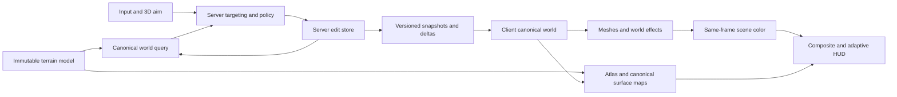

# S2 — Editing, modes, adaptive HUD and maps

Initial design, 22 October 2026. This records requirements and proposed
implementation choices; it does not start implementation or qualify S2.

## Intended result

Look at a reachable block, see the selected target, break it with visible
progress, and place the chosen material. Other players see the same changes;
collision, rendering and later visits agree. The crosshair and HUD remain
readable across bright snow and dark terrain within one element. A minimap
supports local orientation; an interactive world map shows the wider world.

S2 also owns the terrain-model replacement deferred from S1. The separate
world-model study has no accepted production candidate. Its adoption is an
explicit dependency, not something editing or renderer tests can substitute for.

## Requirements and authority

The [product roadmap](../../ROADMAP.md#earlydev-011--basicblocks),
[S2 task](../tasks/MC-AI-0483.md) and
[adaptive-HUD task](../tasks/MC-AI-0484.md) supply the product scope.
The owner's clarification is: **Creative can break bedrock; Survival cannot
fly.** These choices supersede the earlier ambiguity. Existing server hard
restrictions still apply. The [S1 task](../tasks/MC-AI-0482.md) owns the deferred
model boundary and inherited acceptance requirements.

| ID | Required result | Source |
|---|---|---|
| S2-01 | Highlight the reachable block under the view's targeting ray. | Product roadmap |
| S2-02 | Server-authoritative placing/breaking updates ordinary-world rendering, collision and multiplayer state. | S2 task |
| S2-03 | Cracks and cubic particles accompany breaking; normal durations are Snow 1 s, Dirt/Grass 1.5 s, Ice 2 s, Stone 3 s. | Product roadmap |
| S2-04 | Breaking supports blacklist/whitelist, including empty lists, and normal/quick speed. | Product roadmap |
| S2-05 | Spectator has flight/passthrough and no breaking; Creative has collision and quick breaking including bedrock; Survival has collision, no flight and normal breaking excluding bedrock. | Roadmap + owner clarification |
| S2-06 | B cycles placement materials; HUD shows selected block, mode and precise effective permissions. | Product roadmap |
| S2-07 | Center crosshair and HUD support fixed color or independent per-pixel dark/light choice from the scene behind them. | Adaptive-HUD task |
| S2-08 | Integrate an owner-selected, qualified replacement terrain model through the canonical world contract. | S1 scope amendment |
| S2-09 | Preserve world bounds/wrapping, residency/LOD separation and the final accepted S1 gameplay/platform gates. | Existing world contract + S1 task |
| S2-10 | Add a minimap and world map in S2, bringing forward the later map UI scope. | Owner addition, 22 October 2026 |
| S2-11 | Prototype pre-connect loading, world generation, gameplay and world map using current text/background/map primitives; no widget toolkit. | Owner UI request and capability correction |
| S2-12 | Preserve existing FPS/uptime/speed/view/movement/XYZ/YPR and controls; add chunks, measured memory and local climate. Local L1/L2 map uses game colors and prominent N/E/S/W. Hide inapplicable fields. | Owner UI request and refinement |

## Architecture

Current storage preserves some edits by pinning dense chunks. Current terrain
messages lack live edit requests/deltas and skip changed resident content.
The design replaces those limitations with explicit edit state and revisioned
replication; adding mouse handlers alone would leave the feature incomplete.

## Proposed defaults, open to revision

These are assistant design choices, not additional owner decisions.

| Choice | Initial proposal |
|---|---|
| Reach | 5 blocks from the character eye; third-person cameras grant no extra reach. |
| Quick breaking | First authorized server tick; at most one committed edit per player/tick. |
| Input | Left hold breaks; right press places once; B selects; M opens the map; G requests a permitted mode change. |
| Held-input expiry | 300 ms without a refreshed server-side hold lease. |
| Placement defaults | Spectator none; Creative all solids; Survival all solids except bedrock. |
| Startup/mode access | Creative initially; local game permits mode cycling, remote server requires an explicit grant. |
| Unsafe mode switch | Reject atomically and keep the old state; S4 owns automatic embedded recovery. |

Built-in Survival cannot enable flight through F6. Trusted policy overrides
that change preset grants are displayed as a custom configuration with its
base preset and actual rights; no preset overrides a hard restriction.

## Read by responsibility

- [Interaction](earlydev_0_1_1_s2_interaction.md): targeting, permissions, controls and action timing.
- [World state](earlydev_0_1_1_s2_world.md): edit storage, collision, meshing and terrain adoption.
- [Replication](earlydev_0_1_1_s2_replication.md): action ordering, coverage, snapshots and recovery.
- [Rendering](earlydev_0_1_1_s2_rendering.md): effects, pixel contrast and GPU resource ownership.
- [Maps](earlydev_0_1_1_s2_maps.md): minimap/world-map behavior, shared terrain data and input ownership.
- [UI and prototype](earlydev_0_1_1_s2_ui.md): four current-renderer views, telemetry producers and visual/input constraints.
- [Verification and work packages](earlydev_0_1_1_s2_verification.md): implementation boundaries and observable acceptance.

Physical water remains S3; player models/hand animation and bot recovery remain
S4. Menus, inventory and disk save/open remain 0.1.2. The observed S1 source is
changing; the [source record](earlydev_0_1_1_s2_sources.json) identifies the
inspection, and implementation must reconcile it with the final S1 revision.
