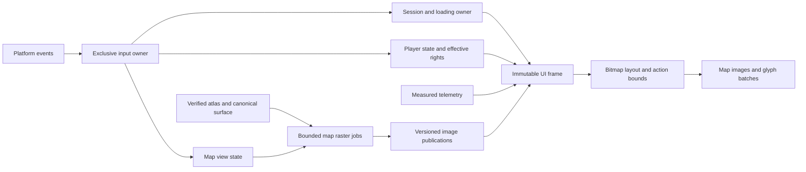

# S2 native presentation architecture

The owner accepted the [UI baseline](earlydev_0_1_1_s2_ui.md) on 22 October
2026. This is its native implementation design, not implemented behavior.
Names and initial budgets below are engineering choices; preserve the accepted
appearance and controls while fitting final S1 interfaces.

## Ownership and data flow

Use the client update owner to build a `UiFrame` value: session/join epoch,
model/config identity, screen state, loading status, player pose/target,
effective mode/edit rights, timestamped metrics and immutable image handles.
Rendering consumes it without world queries, permission decisions or network IO.
The server remains authority for readiness, generation, edits and rights.
Keep loading and presentation as separate state machines: visual stage/time
cannot mutate `WorldLoading` state. World map is a Playing overlay.
[World](earlydev_0_1_1_s2_world.md) and
[replication](earlydev_0_1_1_s2_replication.md) own their identities and recovery.

Keep `UiController` state/layout in client presentation; platform adapters emit
semantic actions. `MapPresentation` owns view/layer state and CPU jobs; the
renderer owns image upload, descriptors and submitted-frame lifetimes.
Reuse public S1 loading/atlas/surface sources instead of querying mutable
generator internals. These are responsibility boundaries, not mandatory new
classes or a generic UI framework.
An atlas-ready flag is not an atlas handle: remote loading may omit that
pointer. Resolve the matching verified client terrain/LOD atlas through its
public source; do not certify a final map from a boolean alone.

## Availability and telemetry

Each sampled value carries Available, Pending, Unavailable or NotApplicable,
units, sample time and matching source identity. Display zero as zero; Pending
and Unavailable get distinct text, NotApplicable disappears. Discard old-epoch
results and clear stale values on reconnect/model change.

FPS counts completed fresh frames; uptime uses the session clock. Chunks count
dense resident chunks, separately from column profiles, LOD nodes and volume
equivalents. Memory is client-process RSS from platform adapters, not cache/GPU
sums. Start with residency updates at most 4 Hz and memory/climate at most 1 Hz;
pose and effective controls follow the frame snapshot. Missing measurements
remain unavailable. Sampling never generates terrain.

Climate samples normalized player XY from the matching canonical model; carry
temperature C, optional relative-humidity percent 0..100, precipitation/model
units, and water applicability/salinity with explicit units. Moisture is a
separate model reservoir. W1 must supply and document a genuine humidity
producer before claiming that field delivered; the accepted unavailable fixture
does not waive it. Show salinity only where a meaningful applicable producer
exists. Do not infer player Z from geological atlas elevation.

## Screen and input state

`Preparing -> Connecting -> Generating/Synchronizing -> ReadyForStart ->
Starting -> Playing` follows the session owner; Failed/Cancelled retain reason
and retry action. Keep the existing S1 request clock and readiness predicates.
The [generation design](earlydev_0_1_1_s2_generation_ui.md) owns its imagery.
Ready input requires the native start scene and fence-confirmed prompt frame
for the current swapchain generation, consumes a
fresh edge, and opens gameplay only after start acknowledgement.
Expose request cancellation through the client/session adapter; invalidate its
epoch and late callbacks. Automatic retries retain T0; new requests replace it.
Visibility pauses visual work, not networking, generation or deadline clocks.

One router owns an event: loading, world map, then gameplay. Opening the map
cancels break holds and clears movement/look input. Closing, focus loss and
resume require fresh edges; held input never becomes an edit. World-map
navigation does not pause multiplayer or send edits/mode changes. F1 keeps its
HUD visibility role; F5/5 changes camera although View text is absent.

Android uses tap-minimap entry, one-pointer map pan, two-pointer pinch and Back
close. Layer/overview/reset/legend text has explicit action bounds; tapping
these text regions cannot pan or edit. This requires S2 hit testing, not a
widget toolkit. Assign pointer owners on down and retain them until up/cancel;
wait for all pointers to release across screen changes. Platform break/place/
next-block actions follow [interaction](earlydev_0_1_1_s2_interaction.md).

## Layout, upload and lifetime

Compute logical bitmap scale, safe area, text runs, minimap reservation and
action bounds together. Use one readout scale per viewport, uniform XYZ,
aligned groups and wrapping; never shrink individual values. Preserve semantic
labels alongside colors. Compact text legends overlay the full map; detailed
legend is explicitly toggled. One logical-to-framebuffer transform governs
images, glyphs and hit regions; snap glyph origins/scales to physical pixels.
Keep the final [rendering](earlydev_0_1_1_s2_rendering.md)
order and same-frame pre-HUD sampling; adaptive text must not sample itself.
Map-backed labels use fixed contrast against their own map/backing.

Publish immutable RGBA8 images with identity/revision/extent. Start with one
worker job and one replaceable pending request per map source, latest wins;
workers never touch UI/GPU state. Keep at most six raster variants per source,
two live presentation sources, and reuse the accepted 128-grid/384-working
formation bounds initially. Cap raster images at 512x512; sample larger source
grids through bounded jobs without limiting terrain-model resolution. Validate
allocation sizes first; cache bounds include retained CPU variants.
Upload only changed revisions through bounded staging slots; defer replacement
when both staging slots per stream are in flight. Retire images/staging by submission fence, never
overwrite submitted data. Resize changes layout, not source identity; device
loss rebuilds GPU resources from retained CPU state. Session change cancels jobs
and rejects late publications. Measure actual native cost against inherited S1
gates; browser timings are not a native frame budget.
