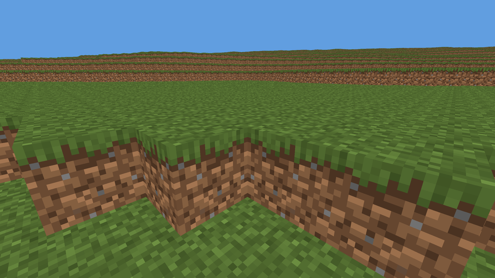

# Overview

BasicBlocks develops the generated world, terrain presentation and local play foundation.

# Snapshots

## EarlyDev 0.1.1:1(26.10.23)

S1 adds the first Terrain-v2 world, generation map and local singleplayer launcher. The owner accepted the playable Windows application for release with remaining performance and visual issues assigned to S2. The release ledger records actual publication and artifact identities separately.

Additions:
1. Seeded continents, climate, snow/ice map classification, surface materials and deterministic terrain references.
2. Vanilla-derived terrain textures, near block meshes, distant terrain LODs and visual world curvature.
3. A centered world-ready start prompt, mouse-button start and clipboard-only F2 screenshots with visual feedback.
4. Standalone Windows singleplayer launch: embedded client and local server, with no console or separate setup.
5. CoreLang 0.1.5 integration pinned to an exact ai-dev revision, with native and scripting evidence retained in the task ledger.

The image is a 2560x1440 macOS production-renderer capture made by a private consumer of the accepted game libraries and shaders. It uses the canonical seed/spawn, a 24-chunk radius, a frozen first-person camera and no debug HUD. The capture reached Playing and reported exact current coverage. The ordinary full-detail target is 40 chunks; this image does not establish that target or performance acceptance. [Capture provenance](images/earlydev-0.1.1-1-terrain.json).

Known release limitations include frame pacing, moving full-detail coverage, terrain/LOD seams and material transitions, focus/input recovery and incomplete platform qualification. Original measurements and concrete acceptance targets are preserved in [S2 delivery targets](../../ai/decisions/earlydev_0_1_1_s2_delivery_targets.md). The [S2 overview](../../ai/decisions/earlydev_0_1_1_s2.md) links the parallel plans; the more elaborate replacement terrain model is deferred to S2.
